# DCMS

CMS ini dibangun menggunakan Haskell: server **WAI + Warp** (tanpa framework web besar),
database **SQLite**, HTML dari **Lucid**, password **bcrypt**, dan konten **Markdown**.

## Fitur

- **Situs publik**: beranda, halaman artikel, arsip kategori, pencarian, paginasi.
- **Login & registrasi** dengan sesi berbasis cookie (token di-hash SHA-256 di database).
- **Dashboard**: statistik, daftar artikel menunggu review, artikel terakhir diperbarui.
- **Editor artikel**: toolbar Markdown, pratinjau, hitung kata, Ctrl+S, slug otomatis.
- **CRUD**: artikel, kategori, pengguna, profil, pengaturan situs.
- **Page builder**: edit halaman langsung di tempat, plus panel **Tampilan situs** untuk mengatur ukuran website
  (lebar konten & jarak tepi) serta warna, jarak, dan bentuk navigasi atas & bawah (berlaku di seluruh situs,
  tersimpan bersama tombol Simpan).
- **Halaman baru** (menu Halaman, Admin & Editor): buat halaman sendiri di `/alamat-halaman` dari 9 templat
  (kosong, standar, landing page, tentang, layanan, harga, FAQ, galeri & video, kontak) atau salin isi halaman
  lain, lalu langsung diedit di page builder. Tiap halaman punya status **Terbit/Draf** (draf hanya terlihat staf,
  otomatis noindex), pilihan **tampil di menu** (atas, bawah, footer) dengan ikon menu, urutan menu (naik/turun),
  SEO sendiri (judul, deskripsi, gambar pratinjau, noindex + pratinjau Google), duplikat, ubah alamat, dan hapus.
  Halaman bawaan tidak bisa dihapus dan alamatnya tetap. Halaman terbit otomatis masuk `sitemap.xml`.
- **Kartu fitur**: 13 gaya (kartu, garis tepi, melayang, ikon di samping, tengah, minimalis, aksen atas/samping,
  bernomor, ikon penuh, gradasi, kaca, gelap), 2–4 kolom, bentuk sudut, dan bentuk ikon lewat chip "Gaya kartu".
- **Blok siap pakai**: testimoni (rating bintang), FAQ (dengan data terstruktur Google), paket harga (paket
  unggulan disorot), tim, galeri, logo klien, dan video YouTube.
- **Gaya situs**: warna utama, 8 pilihan huruf, animasi muncul saat digulir, dan tombol kembali ke atas
  (panel Tampilan situs di editor).
- **SEO & kontak**: deskripsi situs untuk Google dan pratinjau tautan (Open Graph), favicon otomatis, tombol
  WhatsApp melayang, dan ikon media sosial di footer (menu Pengaturan).
- **SEO artikel**: kata kunci utama, judul SEO, deskripsi meta, gambar pratinjau, dan noindex per artikel, dengan
  pratinjau hasil Google dan skor SEO langsung (12 pemeriksaan) saat menulis. Halaman artikel otomatis memuat
  meta Open Graph, canonical, dan data terstruktur BlogPosting.
- **Menu SEO & Analitik** (Admin & Editor): kunjungan harian per sumber (mesin pencari, media sosial, langsung,
  situs lain) tanpa cookie, halaman terpopuler, audit skor SEO semua artikel, serta integrasi Google Search
  Console, Bing, Google Analytics 4, `sitemap.xml`, dan `robots.txt` otomatis. Ringkasannya tampil sebagai
  widget di dashboard.
- **Menu Cabang** (Admin & Editor): kelola cabang/outlet (alamat, telepon & WhatsApp, jam, catatan, tautan peta,
  urutan, aktif/nonaktif). Halaman `/branch` menampilkannya lewat blok **Direktori cabang**: dikelompokkan per
  provinsi, dengan pencarian, filter provinsi (bisa ditautkan: `/branch?provinsi=Bali`, `/branch?cari=surabaya`),
  tombol WhatsApp/peta/rute, dan data terstruktur Store untuk Google. Berisi awal 122 outlet.
  Setiap cabang bernomor urut; tombol **Urutkan dari terdekat** memakai lokasi pengunjung (izin browser,
  butuh HTTPS) untuk menomori cabang dari yang terdekat sampai terjauh, lengkap dengan jaraknya.
  Koordinat cabang diatur di form Cabang (atau diambil otomatis dari tautan Google Maps lengkap).
- **API & API Gateway** (menu khusus Admin): REST API JSON di `/api/v1` untuk web/aplikasi lain — Cabang
  (`/branches`, filter `q`/`province`/`city`, urutan terdekat `near=lat,lng` + `radius_km`, detail, per provinsi),
  Artikel, Kategori, dan Info situs. Tiap API bisa diaktifkan/dimatikan dan diatur aksesnya (publik atau wajib
  API key). API key disimpan sebagai hash, punya cakupan API dan batas permintaan per menit; pemakaian dicatat
  per API dan per key; CORS diatur per domain. Dokumentasi di `/api/docs`, spesifikasi di `/api/openapi.json`.
  Contoh: `curl -H "X-API-Key: dcms_…" https://domain-anda/api/v1/branches?near=-6.2,106.8&per_page=5`
- **Popup gambar**: gambar di halaman dan artikel bisa diklik untuk dibuka besar (tombol panah, Esc untuk
  menutup). Bisa dimatikan di panel Tampilan situs.
- **Blok Kode custom**: HTML, CSS, dan JavaScript sendiri di page builder. Dijalankan di iframe sandbox
  (terpisah dari situs), jadi skripnya tidak bisa membaca sesi login atau memakai hak akses admin.
- **Keamanan**: proteksi CSRF di semua form POST, cookie HttpOnly + SameSite, HTML mentah di Markdown dibuang,
  cegah open redirect, header keamanan, user dinonaktifkan langsung keluar.

## Peran

| Peran | Hak akses |
|---|---|
| **Administrator** | Semua hal: artikel, kategori, pengguna, pengaturan situs |
| **Editor** | Semua artikel (termasuk terbitkan), kategori |
| **User** | Artikel miliknya sendiri; hanya bisa Draf atau "Menunggu review" |

Akun hasil registrasi publik otomatis menjadi **User**. Admin tidak bisa menghapus, menonaktifkan,
atau menurunkan peran akunnya sendiri.

## Menjalankan

Butuh GHC ≥ 9.4 dan cabal (mis. lewat [ghcup](https://www.haskell.org/ghcup/)).

```bash
cabal run DCMS
```

Buka <http://localhost:3000>. Saat database pertama kali dibuat, akun admin dibuat otomatis:

- username: `admin`
- password: `admin12345` (atau nilai `CMS_ADMIN_PASSWORD`)

Segera ganti password lewat **Profil**.

Lupa password? Jalankan `cabal run DCMS -- reset-password admin` (atau di Docker:
`docker compose exec -u 10001 dcms /app/DCMS reset-password admin`). Semua sesi pengguna itu ikut dikeluarkan.

### Variabel lingkungan

| Variabel | Default | Keterangan |
|---|---|---|
| `CMS_PORT` | `3000` | Port HTTP |
| `CMS_DB` | `cms.db` | Lokasi file SQLite |
| `CMS_STATIC` | `static` | Folder CSS/JS |
| `CMS_ASSETS` | `src/asset/img` | Folder gambar (foto profil, gambar halaman), disajikan di `/asset/img/` |
| `CMS_ADMIN_PASSWORD` | `admin12345` di lokal, acak di HTTPS | Password admin awal (hanya saat seed, tidak dicetak ke log) |
| `CMS_SITE_URL`, `CMS_TRUST_PROXY` | — | Untuk produksi, lihat di bawah |

> Fedora tanpa `gmp-devel`: buat symlink `ln -s /usr/lib64/libgmp.so.10 ~/.local/lib/libgmp.so`
> lalu build dengan `LIBRARY_PATH=~/.local/lib cabal build`.

## Struktur

```
app/Main.hs                  konfigurasi dari env, start server Warp, perintah reset-password
src/CMS/Types.hs             tipe domain (User, Post, Branch, Settings, Ctx…), peran & izin
src/CMS/DB.hs                skema, migrasi, seed, dan semua query SQLite
src/CMS/App.hs               middleware (body, sesi, CSRF, header keamanan), routing, analitik, seed
src/CMS/Web.hs               parameter form/query, respons, cookie, flash, redirect
src/CMS/Auth.hs              bcrypt, token acak, hash token
src/CMS/RateLimit.hs         batas percobaan login (per IP, akun, IP+akun)
src/CMS/Blocks.hs            page builder: jenis blok, validasi, templat & halaman bawaan
src/CMS/NavStyle.hs          Tampilan situs: Tema, Navigasi, Footer → variabel CSS
src/CMS/Seo.hs               analisis & skor SEO artikel
src/CMS/Analytics.hs         klasifikasi sumber kunjungan, deteksi bot
src/CMS/Api.hs               katalog & konfigurasi API Gateway
src/CMS/Upload.hs            unggah gambar (cek isi berkas) & sajikan /asset/img
src/CMS/Status.hs            status server (CPU, RAM, disk, uptime) untuk dashboard
src/CMS/BranchSeed.hs        data awal cabang
src/CMS/Handlers/Public.hs   situs publik, login, register, sitemap, robots
src/CMS/Handlers/Admin.hs    dashboard (semua menu /admin)
src/CMS/Handlers/Api.hs      REST API /api/v1 + gateway (key, kuota, CORS)
src/CMS/Views/Layout.hs      kerangka HTML situs & dashboard, header, footer, meta SEO
src/CMS/Views/Site.hs        render blok halaman + mode edit (panel builder)
src/CMS/Views/Public.hs      artikel, kategori, login, register
src/CMS/Views/Admin.hs       dashboard, artikel, kategori, pengguna, profil, pengaturan
src/CMS/Views/PageAdmin.hs   menu Halaman: daftar, buat baru, pengaturan
src/CMS/Views/BranchAdmin.hs menu Cabang
src/CMS/Views/SeoAdmin.hs    menu SEO & Analitik
src/CMS/Views/ApiAdmin.hs    menu API Gateway
src/CMS/Views/ApiDocs.hs     /api/docs & /api/openapi.json
static/style.css             tampilan situs & dashboard
static/app.js                interaksi umum (menu HP, lightbox, popup, form, SEO langsung, dashboard)
static/builder.js            page builder (edit di tempat, seret blok, panel Tampilan situs)
```

## Arsitektur

Diagram di bawah memakai [Mermaid](https://mermaid.js.org) dan tampil otomatis di GitHub/GitLab.

### 1. Gambaran sistem

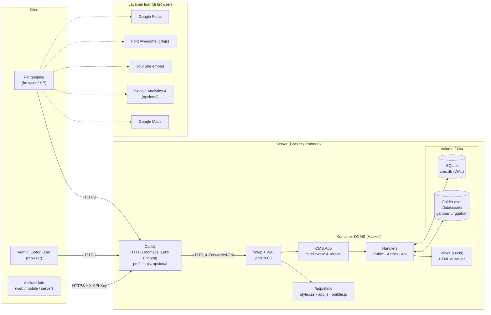

Tanpa Caddy (lokal), Warp diakses langsung di `127.0.0.1:8080`. Satu proses melayani situs, dashboard, dan API. Koneksi SQLite dibungkus `MVar`, jadi aman dipakai banyak thread Warp.

### 2. Lapisan modul

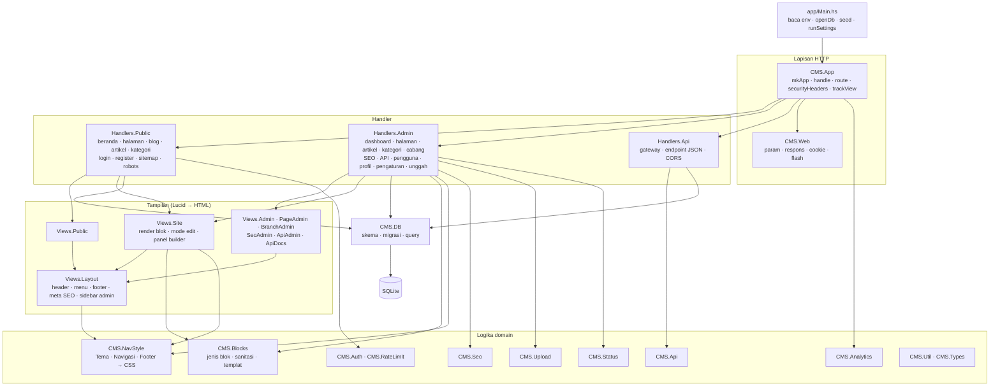

### 3. Siklus satu request

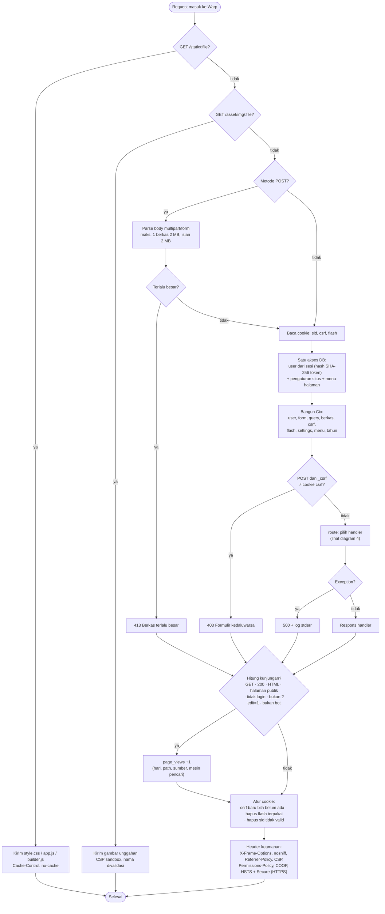

### 4. Routing

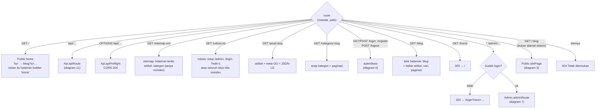

Alamat sistem (`admin`, `api`, `static`, `asset`, `post`, `category`, `login`, `register`, `logout`, `blog`, `home`,
`sitemap.xml`, `robots.txt`, `new`, dll.) tidak pernah dianggap halaman, dan tidak bisa dipakai sebagai alamat
halaman baru.

### 5. Website: menampilkan halaman

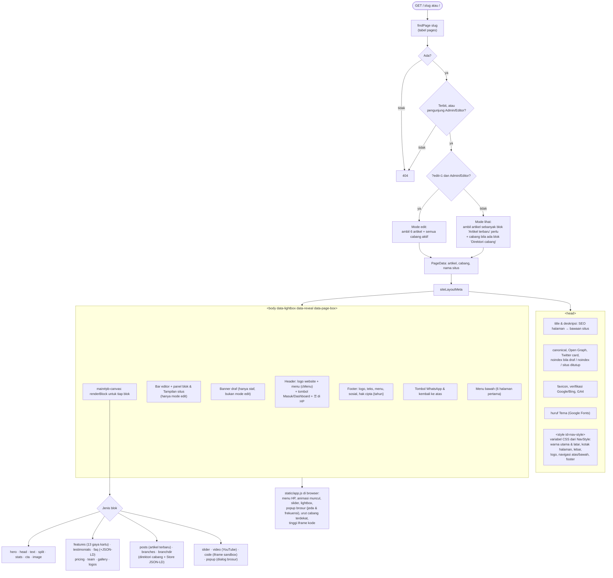

### 6. Login, registrasi, dan sesi

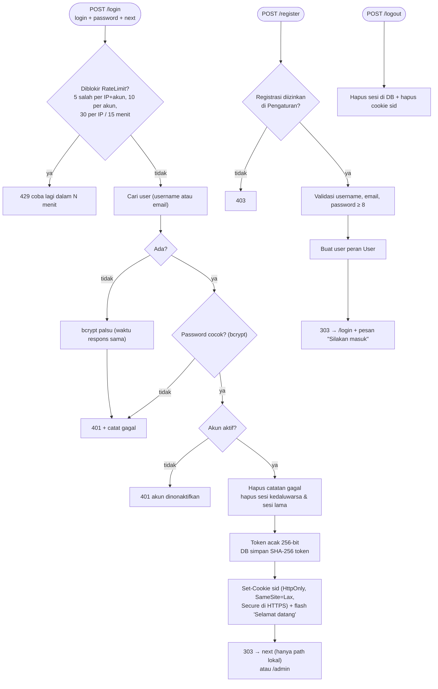

Sesi juga dihapus saat password diganti, peran diubah, akun dinonaktifkan, atau lewat perintah
`DCMS reset-password`.

### 7. Dashboard: menu dan hak akses

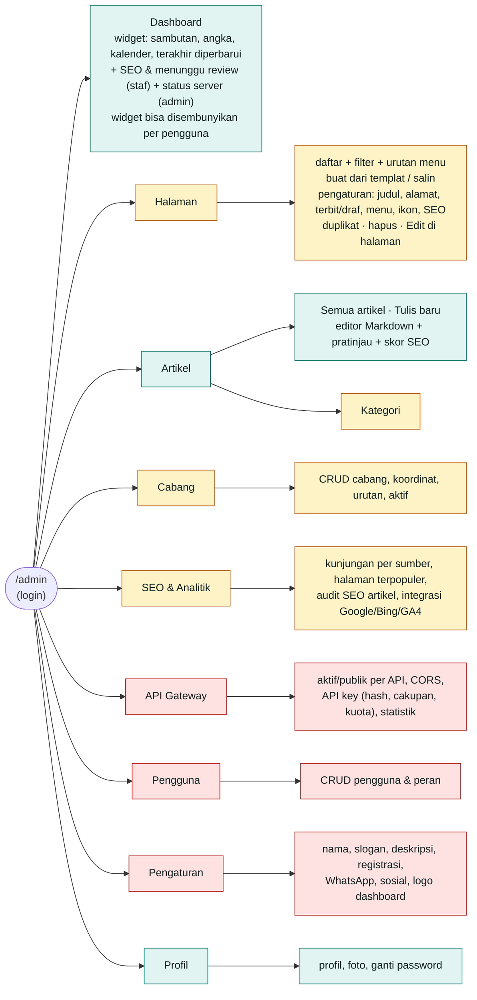

Warna: hijau = semua peran (User hanya artikel miliknya), kuning = Admin & Editor, merah = khusus Admin.
Semua pembatasan diperiksa di server (`staff`/`admin` di `Handlers.Admin`), bukan hanya disembunyikan dari
menu. Integrasi SEO (Google/Bing/GA4) hanya bisa disimpan Admin.

### 8. Page builder: edit di halaman

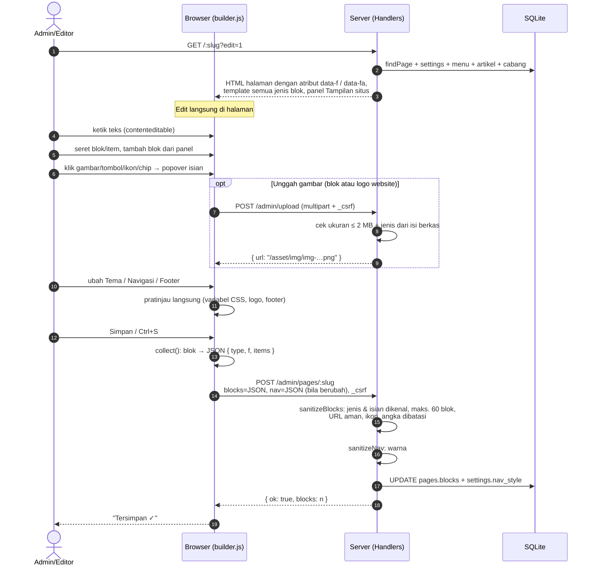

### 9. Membuat halaman baru

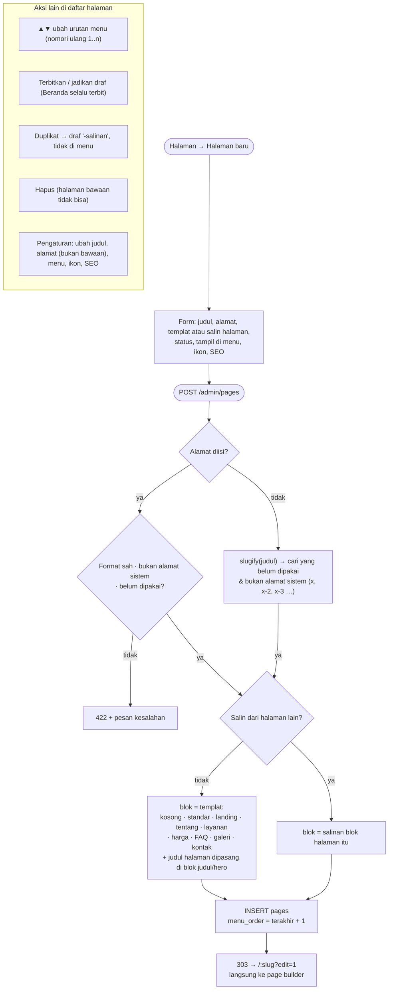

### 10. Alur artikel

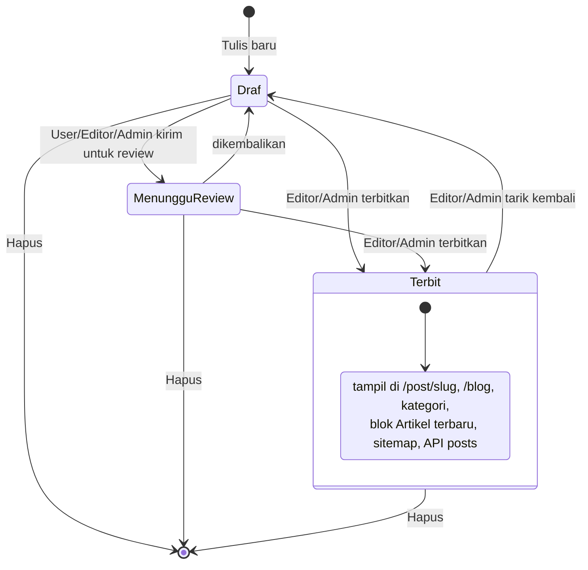

User hanya bisa memilih Draf atau Menunggu review untuk artikelnya sendiri. Saat menulis, skor SEO (12
pemeriksaan) dan pratinjau Google dihitung langsung di browser dengan aturan yang sama seperti `CMS.Seo`.

### 11. API Gateway

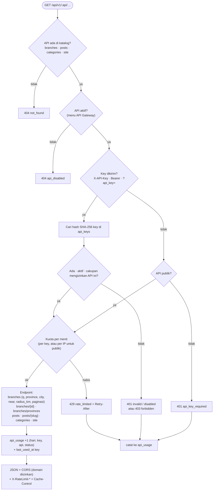

Dokumentasi interaktif ada di `/api/docs`, spesifikasi OpenAPI di `/api/openapi.json`, dan preflight CORS
dijawab di `OPTIONS /api/…`.

### 12. Unggah gambar

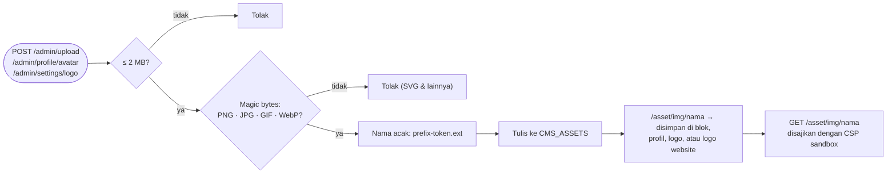

### 13. Analitik kunjungan

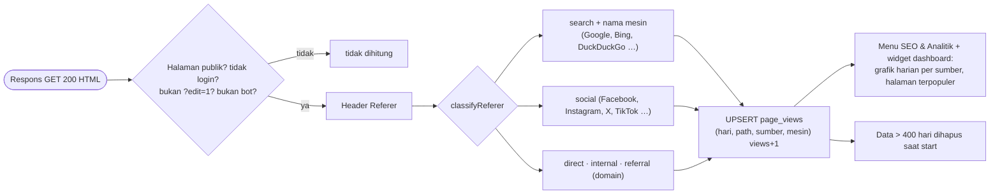

Tidak ada cookie pelacak, IP, atau data pribadi yang disimpan.

### 14. Skema database

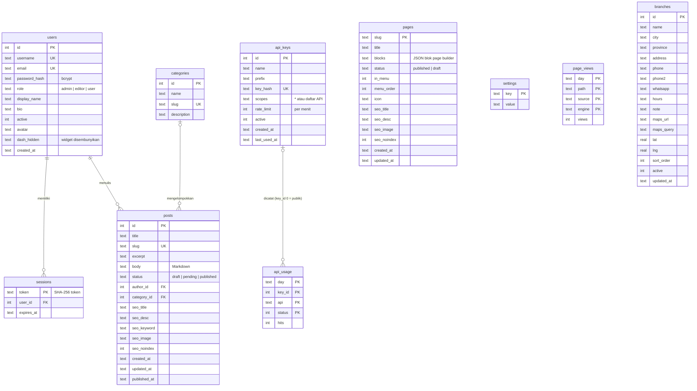

Isi penting tabel `settings`:

| Kunci | Isi |
|---|---|
| `site_name`, `tagline`, `description`, `per_page`, `allow_register` | identitas & perilaku situs (menu Pengaturan) |
| `whatsapp`, `wa_message`, `social_*` | tombol WhatsApp & ikon media sosial |
| `logo` | logo dashboard (juga cadangan logo website & favicon) |
| `seo_google`, `seo_bing`, `seo_ga`, `seo_image`, `seo_index` | integrasi menu SEO |
| `nav_style` | JSON Tampilan situs dari page builder: Tema (warna, latar body & halaman, huruf, lebar, logo website), Navigasi (warna bersama, menu atas & bawah), Footer (isi, warna, ukuran, melayang, sudut) |
| `api_config` | JSON API Gateway: API aktif/publik, CORS |
| `branches_seeded`, `pages_menu_v1`, … | penanda migrasi sekali jalan |

### 15. Saat server mulai

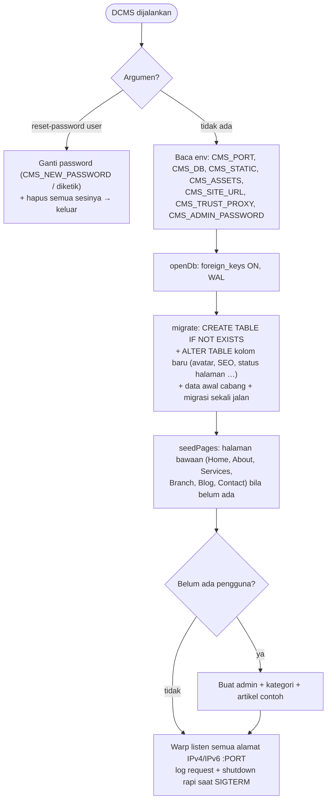

## Rute

| Metode | Path | Akses |
|---|---|---|
| GET | `/`, `/post/:slug`, `/category/:slug` | publik |
| GET/POST | `/login`, `/register`; POST `/logout` | publik |
| GET | `/admin` | login |
| GET/POST | `/admin/posts`, `/admin/posts/new`, `/admin/posts/:id/edit`, `/admin/posts/:id`, `/admin/posts/:id/delete` | login (User: milik sendiri) |
| POST | `/admin/posts/:id/publish` | admin, editor |
| GET/POST | `/admin/categories…` | admin, editor |
| GET | `/:slug` (halaman builder) | publik; draf hanya admin, editor |
| GET/POST | `/admin/pages`, `/admin/pages/new`, `/admin/pages/:slug/settings`; POST `/admin/pages/:slug/{duplicate,toggle,move,delete}` | admin, editor |
| GET/POST | `/admin/users…`, `/admin/settings` | admin |
| GET/POST | `/admin/profile`, `/admin/profile/password` | login |

## Untuk produksi

Semua pengaturan produksi lewat variabel lingkungan:

| Variabel | Fungsi |
|---|---|
| `CMS_SITE_URL` | Alamat resmi situs, mis. `https://contoh.id`. Dipakai untuk canonical, sitemap, dan Open Graph (kebal header Host palsu). Bila diawali `https://`, cookie otomatis diberi `Secure` dan HSTS aktif. |
| `CMS_TRUST_PROXY=1` | Wajib bila berjalan di balik reverse proxy: IP pengunjung diambil dari `X-Forwarded-For` (untuk batas percobaan login). Jangan aktifkan tanpa proxy. |
| `CMS_ADMIN_PASSWORD` | Password akun `admin` saat database pertama kali dibuat. Tidak dicetak ke log. Bila kosong di produksi, dibuat acak dan ditampilkan sekali di log. |
| `CMS_DB`, `CMS_ASSETS`, `CMS_STATIC`, `CMS_PORT` | Lokasi database, folder gambar, folder statis, dan port. |
| `CMS_COOKIE_SECURE=0/1` | Paksa atribut `Secure` cookie (biasanya tidak perlu, ikut `CMS_SITE_URL`). |

### Keamanan bawaan

- Password bcrypt (cost 11); token sesi acak 256-bit, disimpan sebagai hash SHA-256; sesi dihapus saat
  logout, ganti password, atau perubahan peran.
- Cookie `HttpOnly` + `SameSite=Lax` (+ `Secure` di HTTPS); token CSRF di semua form POST.
- **Batas percobaan login**: 5 salah per IP+akun, 10 per akun, 30 per IP dalam 15 menit → dikunci sementara (429).
- Markdown membuang HTML mentah dan tautan `javascript:`; semua teks di-escape oleh Lucid.
- Unggahan dicek dari isi berkas (JPG/PNG/WebP/GIF, maks. 2 MB), nama acak, SVG ditolak; folder aset
  disajikan dengan CSP `sandbox`.
- Blok "Kode custom" berjalan di iframe sandbox (origin terpisah): skripnya tidak bisa membaca sesi.
- Header: `X-Frame-Options`, `X-Content-Type-Options`, `Referrer-Policy`, `Content-Security-Policy`
  (object/base/frame-ancestors), `Permissions-Policy`, `Cross-Origin-Opener-Policy`, dan HSTS di HTTPS.
- Pembatasan peran diperiksa di server (User tidak bisa menerbitkan, mengedit milik orang lain, atau membuka menu staf).

## Menjalankan dengan Docker

Butuh Docker Engine + plugin Compose. Semua diatur di `docker-compose.yml` (image dari `Dockerfile`).

**Coba di komputer sendiri** (tanpa HTTPS):

```bash
cp .env.example .env        # isi CMS_ADMIN_PASSWORD (opsional; tanpa itu password admin = admin12345)
docker compose up -d --build
docker compose logs -f dcms # tunggu "DCMS berjalan di port 3000"
```

Buka <http://localhost:8080/admin> dan login sebagai `admin`. Port diatur lewat `DCMS_PORT` di `.env`;
bawaan hanya bisa diakses dari komputer ini (`DCMS_BIND=127.0.0.1`).

**Server produksi dengan HTTPS** (Caddy + Let's Encrypt; domain harus sudah mengarah ke server). Di `.env`
aktifkan `DCMS_DOMAIN`, `CMS_SITE_URL=https://domain-anda`, dan `CMS_TRUST_PROXY=1`, lalu:

```bash
docker compose --profile https up -d --build
```

Perintah berguna:

```bash
docker compose ps                                # status & health
docker compose up -d --build                     # update setelah git pull
docker compose down                              # berhenti (data tetap ada di volume dcms-data)
docker cp cms.db dcms:/data/cms.db && docker restart dcms   # pakai database lama
docker compose exec -u 10001 dcms /app/DCMS reset-password admin  # lupa password (diketik)
docker run --rm -v dcms-data:/data -v "$PWD":/backup debian:bookworm-slim \
  tar czf /backup/dcms-$(date +%F).tar.gz -C /data .        # backup volume
```

Ingin memakai folder host sebagai data? Ganti `dcms-data:/data` di `docker-compose.yml` dengan mis.
`/srv/dcms:/data` (tambah `:Z` bila SELinux aktif). Pemilik isinya (termasuk `cms.db` lama) dirapikan
otomatis saat kontainer mulai.

## Deploy dengan Podman di AWS

Rekomendasi: **satu instans EC2** (Amazon Linux 2023 atau Ubuntu 24.04) dengan disk EBS. Database SQLite
butuh disk lokal yang awet, jadi ECS Fargate/App Runner tanpa disk tetap **tidak** cocok.

Berkas yang disediakan:

- `Dockerfile` — image dua tahap (build Haskell → runtime Debian slim, aplikasi berjalan sebagai user non-root, healthcheck). Dipakai Docker maupun Podman.
- `docker-compose.yml` — DCMS (+ Caddy HTTPS otomatis dengan `--profile https`), untuk Docker atau `podman compose`.
- `deploy/quadlet/` — unit systemd (Podman Quadlet): jalan otomatis saat boot dan restart bila crash.
- `deploy/Caddyfile`, `.env.example`.

**1. Siapkan EC2**

- Tipe: `t3.small`/`t4g.small` atau lebih (build GHC butuh ±3 GB RAM; tambahkan swap 2–4 GB bila RAM 2 GB).
- Disk: EBS gp3 20 GB. Pasang Elastic IP, lalu arahkan DNS domain (A record) ke IP tersebut.
- Security group: buka **80** dan **443** untuk semua, **22** hanya untuk IP Anda. Port 3000 **jangan** dibuka.

**2. Pasang Podman & build image**

```bash
sudo dnf install -y podman git          # Ubuntu: sudo apt install -y podman git
git clone <repo-anda> dcms && cd dcms   # atau salin folder proyek dengan scp/rsync
sudo podman build --format docker -t localhost/dcms:latest .
```

**3. Konfigurasi & jalankan (Quadlet/systemd)**

```bash
sudo mkdir -p /etc/dcms
sudo cp deploy/Caddyfile /etc/dcms/Caddyfile
sudo tee /etc/dcms/dcms.env >/dev/null <<'ENV'
DCMS_DOMAIN=contoh.id
CMS_SITE_URL=https://contoh.id
CMS_ADMIN_PASSWORD=ganti-dengan-password-kuat
ENV
sudo chmod 600 /etc/dcms/dcms.env
sudo cp deploy/quadlet/* /etc/containers/systemd/
sudo systemctl daemon-reload
sudo systemctl start dcms caddy
sudo podman logs dcms                   # cek "[config] … cookie Secure: True"
```

Buka `https://contoh.id/admin`, login sebagai `admin`, lalu **segera ganti password** di menu Profil.
Di menu **SEO & Analitik → Integrasi**, kirim `https://contoh.id/sitemap.xml` ke Google Search Console.

Alternatif tanpa systemd: `cp .env.example .env` (isi), lalu `podman compose --profile https up -d`.

**Memindahkan data lama (opsional)** — salin `cms.db` dan folder gambar ke volume, lalu nyalakan:

```bash
sudo systemctl stop dcms
sudo podman volume create dcms-data
sudo cp cms.db "$(sudo podman volume inspect dcms-data --format '{{.Mountpoint}}')/cms.db"
sudo cp -r src/asset/img "$(sudo podman volume inspect dcms-data --format '{{.Mountpoint}}')/assets"
sudo systemctl start dcms     # pemilik berkas dirapikan otomatis saat kontainer mulai
```

**4. Update aplikasi**

```bash
git pull && sudo podman build --format docker -t localhost/dcms:latest . && sudo systemctl restart dcms
```

**5. Backup**

Data ada di volume `dcms-data` (database + gambar unggahan). Cara termudah: jadwalkan **snapshot EBS**
harian lewat AWS Backup. Untuk salinan manual:

```bash
sudo systemctl stop dcms && sudo podman volume export dcms-data > dcms-$(date +%F).tar && sudo systemctl start dcms
```

**Pemecahan masalah: "readonly" / "Permission denied"**

Aplikasi berjalan sebagai user `dcms` (uid 10001), bukan root. Saat kontainer mulai, entrypoint merapikan
pemilik isi `/data` (mis. `cms.db` yang disalin sebagai root, atau folder host) lalu menurunkan hak ke user
tersebut, jadi biasanya tidak perlu apa-apa. Bila tetap muncul `attempt to write a readonly database` atau
`Permission denied`, log kontainer menampilkan `GALAT: …` beserta cara memperbaikinya:

- Jangan jalankan dengan `--user`/`user:` lain, dan jangan buang hak `CHOWN`, `SETUID`, `SETGID` (sudah
  diatur di `docker-compose.yml` dan `deploy/quadlet/dcms.container`).
- Atau ubah pemilik di host: `sudo chown -R 10001:10001 <folder-data>`.
- SELinux (Fedora/RHEL) dengan folder host: tambahkan `:Z`, mis. `-v /srv/dcms:/data:Z`.
- Pesan `Read-only file system` saat menulis ke luar `/data` itu disengaja (root filesystem hanya-baca);
  semua data aplikasi memang disimpan di `/data`.
